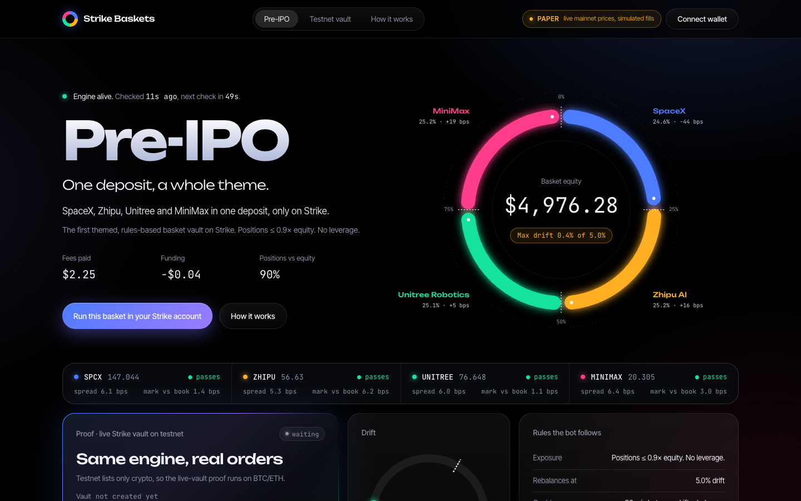
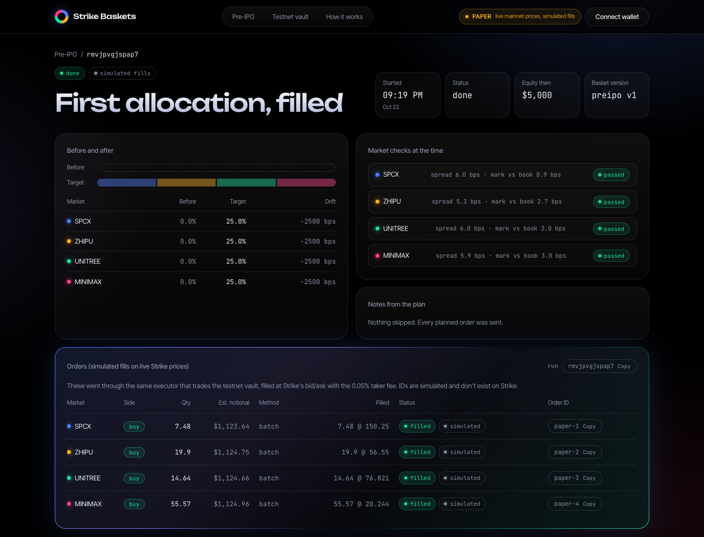
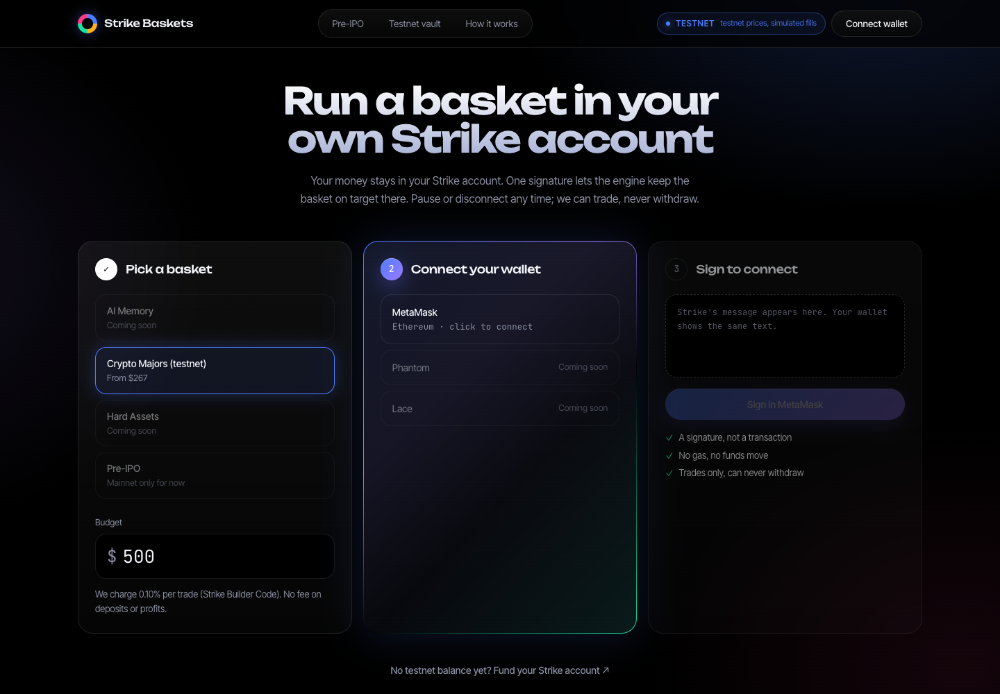
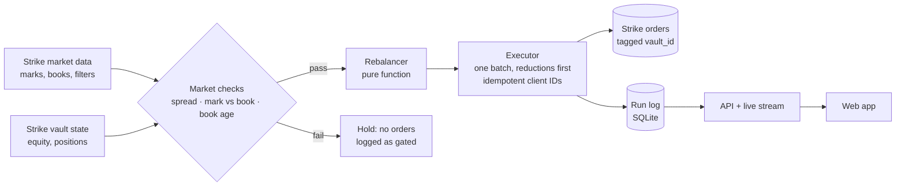
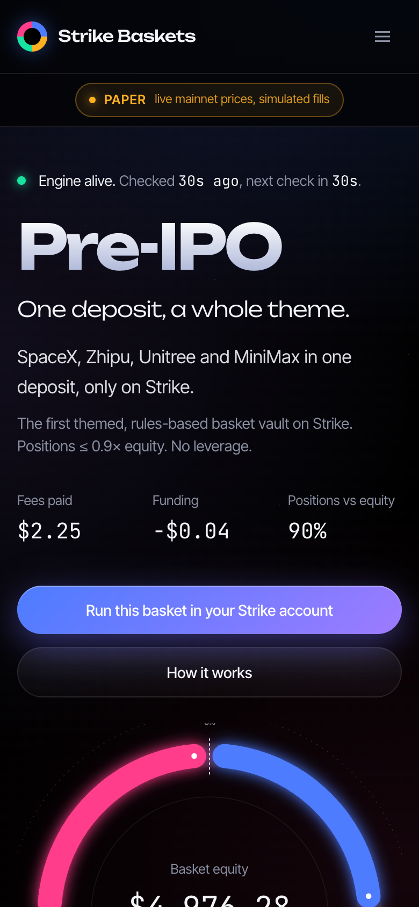

<div align="center">

# Strike Baskets

### One deposit, a whole theme.

**The first themed, rules-based basket vault on [Strike Finance](https://strikefinance.org).**<br>
SpaceX, Zhipu, Unitree and MiniMax in one position, markets that exist only on Strike, kept on target by a bot that can trade but never withdraw.


-9D7BFF?style=flat-square)




</div>

---

## The problem

Strike lists markets you can't trade anywhere else: **pre-IPO perps** for SpaceX, Zhipu AI, Unitree Robotics and MiniMax, plus stock perps. To get exposure to a *theme* today, you'd open four positions, size them yourself, and rebalance by hand every time prices move. Most people won't. The ones who do, drift.

## The solution

**Strike Baskets turns a theme into one deposit.**

- **Pick a theme.** The live basket is **Pre-IPO**: four Strike-only markets at 25% each.
- **Deposit once on Strike.** Your money sits in a Strike user vault, not with us.
- **The bot keeps it on target.** When any weight drifts 5 points, it sends one batch of orders to bring the basket back. Fixed, published rules. No discretion, no leverage.
- **Every trade is public.** Each rebalance is logged with its before/after weights, market checks and order IDs.

**Or keep the money in your own Strike account.** Connect a wallet with one signature through **Strike Builder Connect**, pick a budget, and the same engine runs the basket in your account. Pause or disconnect any time. We can trade, never withdraw.

---

## Two-minute tour for judges

| Look at | What it shows | Where |
|---|---|---|
| **The orbit ring** | Each arc is a market's *current* weight; dashed ticks mark the *targets*. The gap is the drift. | `/` hero |
| **"Same engine, real orders"** | The same code trading a real Strike vault on testnet, with order IDs you can copy and find on Strike. | `/` proof card → `/testnet` |
| **A rebalance** | Before → target, the market checks at that moment, and every order with its ID. | `/rebalances/:id` |
| **Market checks** | Every market's spread and mark-vs-book, live. A failing book means no orders: the run is logged as `gated`. (On testnet, SOL/ADA books sat 17–26% off mark and were refused.) | ticker strip, rebalance detail |
| **Personal mode** | Wallet signature → the bot runs the basket in *your* Strike account. | `/connect` → `/me` |

<table>
<tr>
<td width="50%"><br><sub><b>Rebalance detail.</b> Before → target, market checks at the time, every order and its ID.</sub></td>
<td width="50%"><br><sub><b>Personal mode.</b> Pick a basket, connect MetaMask, sign Strike's own message. No gas, no funds move.</sub></td>
</tr>
</table>

---

## Proof

| | |
|---|---|
| **Testnet vault (live Strike orders)** | _Vault ID, run IDs and Strike order IDs: added before submission_ |
| **Personal mode on testnet** | Builder code **`StrikeBasket`** registered; Builder Connect round-trip verified with a real wallet signature. _First personal-mode order IDs: added before submission_ |
| **Pre-IPO basket on mainnet prices** | Runs on live Strike mainnet prices with simulated fills. _Running since: added before submission_ |

**Honest line:** we didn't put real money in for the hackathon, so the Pre-IPO basket fills on paper: at Strike's live bid/ask, with Strike's 0.05% taker fee and live funding, through **the same executor** that trades the testnet vault. Only the venue differs. Vault orders on the pre-IPO markets themselves are untested until a mainnet vault is funded.

---

## How it works



Every cycle:

1. **Read** equity and positions from Strike, the source of truth.
2. **Check** each market's book: spread ≤ 0.5%, mark within 1% of the book mid, book ≤ 60 s old. Off-hours pre-IPO books are the main live risk, and a failing book means no trade.
3. **Plan** with a pure function: target = equity × 0.9 × weight. Rebalance when any weight is 5 points off target. Legs below Strike's minimum order size are skipped with a reason.
4. **Execute** one batch of orders, reductions first, each with an idempotent `client_order_id`, then confirm each by that ID.
5. **Record** the run, its orders and a snapshot, and stream it to the page.

**The bot never re-sends an order.** It replans from Strike's actual positions on the next cycle, so a crash or a timeout can't double-trade.

---

## Built deep on Strike

| Strike capability | How we use it | Code |
|---|---|---|
| **Strike-only markets** | Pre-IPO perps (SpaceX, Zhipu, Unitree, MiniMax) are the product | [`backend/baskets/`](backend/baskets/) |
| **User vaults: leader orders** | Batch orders tagged with `vault_id` | [`executor.ts`](backend/src/engine/executor.ts), [`client.ts`](backend/src/strike/client.ts) |
| **Builder Codes + Builder Connect** | Wallet-signature onboarding for personal mode; `X-Builder-Fee-Bps` on fills | [`personal/manager.ts`](backend/src/personal/manager.ts) |
| **API wallet auth** | Ed25519-signed requests from a trade-only key | [`sign.ts`](backend/src/strike/sign.ts) |
| **TWAP** (`/v2/algo/twap`) | Optional for large legs; batch orders are the default | [`executor.ts`](backend/src/engine/executor.ts) |
| **Per-symbol settings** | Cross margin at a 2x setting on every market | `Executor.ensureSymbolSettings` |
| **Market data** | `exchangeInfo` filters, mark prices, book tickers | [`gates.ts`](backend/src/core/gates.ts) |
| **Public vault data** | Share price, equity, depositors, positions | [`engine.ts`](backend/src/engine/engine.ts) |

We also wrote down every place the live API differs from the docs: [`docs/STRIKE-API-NOTES.md`](docs/STRIKE-API-NOTES.md).

---

## Safe by construction

| Rule | Default |
|---|---|
| Exposure | **Positions ≤ 0.9× equity. No leverage.** The config refuses anything above 1×. |
| Margin | Cross, 2x setting per symbol: effective exposure stays under 1× |
| Order caps | $2,000 per order, $5,000 per run |
| Drift trigger | 5 points, then a 30-minute cooldown between drift rebalances |
| Market checks | Spread ≤ 50 bps, mark within 100 bps of book mid, book ≤ 60 s old |
| Pause and flatten | Admin pause, shown publicly on the page; flatten works only while paused |
| Withdrawals | **The bot can't.** Its key trades only. Deposits and withdrawals happen on Strike. |
| Mainnet write lock | The HTTP client refuses every mainnet order unless `ALLOW_MAINNET_WRITES=yes` |

## Engineering

- **45 tests passing** across the rebalancer, market checks, request signing, the engine cycle, paper fills, personal mode and the mainnet write lock (`pnpm test`).
- **Crash-safe execution:** idempotent client order IDs, confirmation by ID, replan instead of retry.
- **Pure rebalancer** tested against Strike's real mainnet order-size filters.
- **Private by design:** personal-mode runs are stored per user and never appear in the public log or stream; user keys are encrypted at rest (AES-256-GCM).
- **Live UI:** React + TanStack Query over a Server-Sent Events stream, with a polling fallback. Every page works on a phone.

<p align="center"></p>

---

## Business model

Two revenue lines, both native to Strike:

- **Vault leader commission:** 0–50% (default 10%), charged only on profitable withdrawals.
- **Builder fee** on personal-mode fills: we charge 0.10%; Strike allows up to 1%.

Every basket brings Strike deposits and steady rebalancing volume on its unique markets.

## Roadmap

1. **Pre-IPO vault on mainnet**: mostly configuration, since the same executor already runs paper and testnet. First step is a small live order test on the pre-IPO markets.
2. **More themes** on the same engine: AI Memory (Micron, SK Hynix, SanDisk, CXMT), Hard Assets (gold, oil).
3. **Strategist marketplace**: anyone publishes a basket's rules and earns the leader commission; the engine does the rest.

---

## Run it

Requires Node ≥ 22.13 and pnpm.

```bash
pnpm install

# Backend (one terminal each)
cd backend
pnpm test                    # 45 tests
pnpm preipo                  # Pre-IPO on live mainnet prices, simulated fills. No keys needed. :8787
pnpm testnet                 # testnet engine + personal mode (Builder Connect). :8788

# Web app (second terminal)
cd frontend
cp .env.example .env.local   # VITE_API_URL + optional VITE_TESTNET_API_URL
pnpm dev                     # http://localhost:5173
```

More: `pnpm plan --basket preipo --env mainnet --equity 500` (dry-run plan on live prices), `pnpm probe` (go/no-go checks). Every setting is documented in [`backend/.env.example`](backend/.env.example); the testnet and personal-mode setup is in [`docs/HANDOFF.md`](docs/HANDOFF.md) §7.

## What we don't claim

No performance claims: the vault is days old. It's a basket vault of perpetual futures, not an index fund. Strike already has user vaults; this is the first **themed, rules-based basket** vault.

## Repository

| Path | What's there |
|---|---|
| [`backend/`](backend/) | Engine, Strike client, rebalancer, API (TypeScript, Fastify, SQLite) |
| [`frontend/`](frontend/) | Web app (React, Vite, Tailwind, TanStack Query, lightweight-charts) |
| [`docs/HANDOFF.md`](docs/HANDOFF.md) | Current state, decisions and next steps. **Start here.** |
| [`docs/FRONTEND.md`](docs/FRONTEND.md) | Web app spec and API contract |
| [`docs/PERSONAL-MODE.md`](docs/PERSONAL-MODE.md) | Personal mode (Builder Connect) |
| [`docs/STRIKE-API-NOTES.md`](docs/STRIKE-API-NOTES.md) | Verified Strike API facts |
| [`docs/PLAN.md`](docs/PLAN.md) | Runbook and go/no-go checklist |

<div align="center"><sub>Built for the Strike Hackathon, 21–23 October 2026. Planning happened before the window; all code was written during it.</sub></div>
